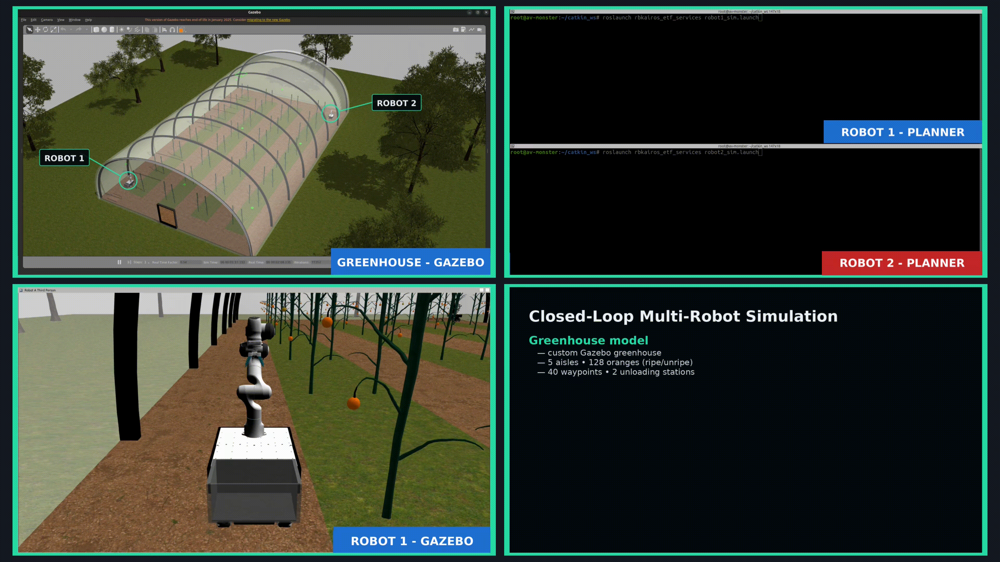

# HARBOT Agri Simulation

A ROS workspace for experiments with multiple robots in a greenhouse environment for the HARBOT project.

This repository provides a ROS Noetic and Gazebo Classic simulation setup based on the RBKairos mobile base integrated with a robotic manipulator, adapted for greenhouse-based research experiments.



**[Watch the full simulation system overview](https://www.dropbox.com/scl/fi/a84vjmc8g44aoa231ryps/harbot_simulation_features.mp4?rlkey=xneqs1onafdokjcb1fav9ost0&raw=1)**

---

## Requirements

The simulation has been developed and tested with:

- **Ubuntu 20.04**
- **ROS Noetic**
- **Gazebo Classic (Gazebo 11)**

Recommended hardware (tested configuration):

- **GPU:** NVIDIA Quadro RTX 4000 (8GB VRAM)
- **CPU:** Intel i7-class processor
- **RAM:** 16 GB or higher recommended

---

## Package Layout

The retained code is consolidated into six HARBOT packages with clear ownership:

- `harbot_description`: mobile base, arm, gripper, and combined robot models
- `harbot_control`: base, arm, gripper, and container controllers
- `harbot_simulation`: Gazebo worlds, models, spawning, RViz, and simulation bringup
- `harbot_navigation`: saved greenhouse paths and the custom path planner/controller
- `harbot_moveit`: Franka 6-finger and UR5-EGH MoveIt profiles
- `harbot_harvest`: perception, harvesting workflow, and PROST integration

The simulation-specific ROS packages are grouped under `simulation_plugins/`:

- `gazebo_ros_link_attacher`: simulated link attachment and detachment
- `roboticsgroup_gazebo_plugins`: mimic-joint support for the custom grippers
- `realsense_d435_gazebo`: the integrated D435/D435i model and Gazebo plugins

They remain independent ROS packages even though they are grouped in one directory. Source and license provenance for consolidated or adapted upstream files is retained with the relevant package.

---

## System Overview

Below is a brief overview of the simulation setup:

- **Planning:** Waypoint-to-waypoint navigation uses pre-recorded JSON paths through the greenhouse rows.
- **Control:** A custom path controller follows the selected path through the mobile base velocity interface. The controller supports holonomic/omnidirectional motion for the RB-Kairos base.
- **Localization:** Robot pose is currently taken from Gazebo ground-truth odometry.
- **Perception:** The Franka wrist D435 supplies synchronized color and depth images. An HSV detector estimates the selected orange's 3D position; waypoint-to-fruit names and ripeness are still configured in the workflow.
- **Manipulation:** MoveIt plans the arm to the detected 3D target. The simulated grasp then attaches the selected fruit to the gripper.

---

## Build

Clone the repository into your catkin workspace:

```bash
cd ~/catkin_ws/src
git clone https://github.com/AV-Lab/harbot-agri-simulation.git
```

All Gazebo and Realsense integration packages required by the default simulation are included under `simulation_plugins/`.

The PROST harvesting integration additionally expects [`rbkairos_etf_services`](https://github.com/Syed-Abbas-Hussain/rbkairos_etf_services/tree/SIM-integration) and its `prost_ros` dependency in the same workspace. They are already present in `harbot_agri_sim`, but are not included in this repository and have no rosdep definitions. Add them to `~/catkin_ws/src` before installing dependencies when using the PROST action-server integration. The core Gazebo and MoveIt simulation can run without them.

Install dependencies:

```bash
cd ~/catkin_ws
rosdep install --from-paths src --ignore-src -r -y --skip-keys=stomp_moveit
```

The default OMPL/RRTConnect arm planner and the retained OMPL-CHOMP pipeline use released ROS Noetic packages. The optional STOMP pipeline is also retained, but `stomp_moveit` must be [added to the workspace from source](https://moveit.github.io/moveit_tutorials/doc/stomp_planner/stomp_planner_tutorial.html) before selecting it because it has no Ubuntu 20.04/Noetic rosdep definition.

Build the workspace:

```bash
catkin build
```

Source the workspace:

```bash
source devel/setup.bash
```

---

## Usage

Before starting the simulation, from the repository root set the Gazebo model path:

```bash
export GAZEBO_MODEL_PATH=$GAZEBO_MODEL_PATH:$PWD/harbot_simulation/models
```

Launch the complete RB-Kairos simulation:

```bash
roslaunch harbot_simulation rbkairos_complete.launch
```

This starts Gazebo along with the required ROS controllers.
The launch file supports spawning the robots at predefined greenhouse waypoints.

The greenhouse waypoint layout used by the navigation and harvesting workflow is shown below. This map is useful when selecting robot spawn waypoints, checking saved path endpoints, and understanding the zigzag traversal order across the rows.


Waypoint ranges:

- robot A uses `a1` to `a20`
- robot B uses `a21` to `a40`

Example launch with robot A at `a1` and robot B at `a40`:

```bash
roslaunch harbot_simulation rbkairos_complete.launch waypoint_robot_a:=a1 waypoint_robot_b:=a40
```

For a Franka robot, select a retained MoveIt pipeline with `moveit_pipeline_a:=ompl`, `stomp`, `ompl_chomp`, `chomp`, or `pilz_industrial_motion_planner` (and the corresponding `_b`/`_c` argument for another robot). The UR5 profile supports `ompl`, `chomp`, and `pilz_industrial_motion_planner`.

After the simulation is running, start the harvesting workflow:

```bash
rosrun harbot_harvest harvest_workflow.py
```

The workflow asks for:

- robot selection: `a` for `/robot`, `b` for `/robot_b`
- whether to launch the path GUI
- whether to run a full automatic test or use manual waypoint selection

Manual mode detects the current waypoint, shows reachable waypoints or unloading stations, navigates using saved paths, and lists the oranges available at the reached waypoint. Selected fruits are harvested one by one.

Automatic mode starts from the current waypoint, harvests all configured ripe fruits, skips configured unripe fruits, moves through the remaining waypoints in order, then navigates to the robot's unloading station and opens the container bottom.

Robot waypoint order in automatic mode:

- robot A: `a1` to `a8`, then `a16` to `a9`, then `a17` to `a20`
- robot B: `a40` to `a33`, then `a25` to `a32`, then `a24` to `a21`

The path GUI can be enabled from the workflow prompt. It is started once and kept open while individual path executions are restarted as needed.

Start the PROST/perception stack for each robot with:

```bash
roslaunch harbot_harvest prost_harvest.launch robot_ns:=/robot
roslaunch harbot_harvest prost_harvest.launch robot_ns:=/robot_b
```

---

## Known Limitations

This repository currently models orange harvesting at a simulation-workflow level. Some physical details are simplified:

- Each orange uses a support structure in the Gazebo world. This is a workaround because the current model does not yet simulate a stem that physically holds the orange and breaks when enough force is applied.
- Orange position is camera-detected, but fruit identity, waypoint membership, and ripeness are still configured rather than classified visually.
- The harvesting workflow currently targets the Franka wrist-camera and gripper conventions. The UR5 simulation and basic MoveIt planning/execution work, but its end-to-end perception and grasp workflow still needs adaptation after the planned D435 port.
