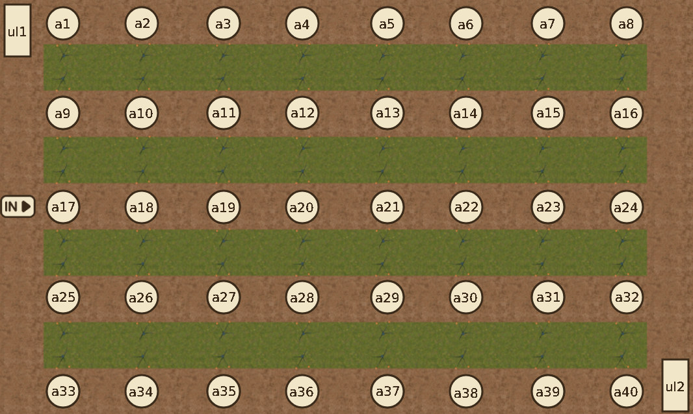

# HARBOT Agri Simulation

A ROS workspace for experiments with multiple robots in a greenhouse environment for the HARBOT project.

This repository provides a ROS Noetic and Gazebo Classic simulation setup based on the RBKairos mobile base integrated with a robotic manipulator, adapted for greenhouse-based research experiments.


Full demo video: [Download here](https://www.dropbox.com/scl/fi/9pud7ad7zqz1ohbytssr9/agri_final_demo.mp4?rlkey=azn2opi42kuegtdal0o9ienq9&raw=1)

---

## Requirements

The simulation has been developed and tested with:

- **Ubuntu 20.04**
- **ROS Noetic**
- **Gazebo Classic (Gazebo 11)**

Recommended hardware (tested configuration):

- **GPU:** NVIDIA Quadro RTX 4000 (8GB VRAM)
- **CPU:** Intel i7-class processor
- **RAM:** 16 GB or higher recommended

---

## Included Base Packages

This workspace includes the following upstream repositories as the base simulation framework. Some packages may be modified or extended for the HARBOT use case.

- [rbkairos_sim](https://github.com/RobotnikAutomation/rbkairos_sim)
- [egh_gripper_common](https://github.com/RobotnikAutomation/egh_gripper_common)
- [rbkairos_common](https://github.com/RobotnikAutomation/rbkairos_common)
- [roboticsgroup_gazebo_plugins](https://github.com/RobotnikAutomation/roboticsgroup_gazebo_plugins)
- [robotnik_sensors](https://github.com/RobotnikAutomation/robotnik_sensors)
- [summit_xl_common](https://github.com/RobotnikAutomation/summit_xl_common)
- [universal_robot](https://github.com/fmauch/universal_robot)
- [wsg50-ros-pkg](https://github.com/RobotnikAutomation/wsg50-ros-pkg)
- [robotnik_msgs](https://github.com/RobotnikAutomation/robotnik_msgs)
- [franka_ros](https://github.com/frankarobotics/franka_ros.git)

---

## System Overview

Below is a brief overview of the simulation setup:

- **Planning:** Waypoint-to-waypoint navigation uses pre-recorded JSON paths through the greenhouse rows.
- **Control:** A custom path controller follows the selected path through the mobile base velocity interface. The controller supports holonomic/omnidirectional motion for the RB-Kairos base.
- **Localization:** Robot pose is currently taken from Gazebo ground-truth odometry.
- **Perception:** Fruit perception is not implemented yet. The workflow uses configured fruit metadata instead of camera-based detection.
- **Manipulation:** Fruit reaching is handled with MoveIt. The arm moves to configured fruit target positions and the fruit is attached to the gripper during the simulated grasp.

---

## Build

Clone the repository into your catkin workspace:

```bash
cd ~/catkin_ws/src
git clone https://github.com/AV-Lab/harbot-agri-simulation.git
```

Install dependencies:

```bash
cd ~/catkin_ws
rosdep install --from-paths src --ignore-src -r -y
```

Build the workspace:

```bash
catkin build
```

Source the workspace:

```bash
source devel/setup.bash
```

---

## Usage

Before starting the simulation, from the repository root set the Gazebo model path:

```bash
export GAZEBO_MODEL_PATH=$GAZEBO_MODEL_PATH:$PWD/rbkairos_sim/rbkairos_gazebo/models
```

Launch the complete RB-Kairos simulation:

```bash
roslaunch rbkairos_sim_bringup rbkairos_complete.launch
```

This starts Gazebo along with the required ROS controllers.
The launch file supports spawning the robots at predefined greenhouse waypoints.

The greenhouse waypoint layout used by the navigation and harvesting workflow is shown below. This map is useful when selecting robot spawn waypoints, checking saved path endpoints, and understanding the zigzag traversal order across the rows.



Waypoint ranges:

- robot A uses `a1` to `a20`
- robot B uses `a21` to `a40`

Example launch with robot A at `a1` and robot B at `a40`:

```bash
roslaunch rbkairos_sim_bringup rbkairos_complete.launch waypoint_robot_a:=a1 waypoint_robot_b:=a40
```

After the simulation is running, start the harvesting workflow:

```bash
rosrun rbkairos_sim_bringup harvest_workflow.py
```

The workflow asks for:

- robot selection: `a` for `/robot`, `b` for `/robot_b`
- whether to launch the path GUI
- whether to run a full automatic test or use manual waypoint selection

Manual mode detects the current waypoint, shows reachable waypoints or unloading stations, navigates using saved paths, and lists the oranges available at the reached waypoint. Selected fruits are harvested one by one.

Automatic mode starts from the current waypoint, harvests all configured ripe fruits, skips configured unripe fruits, moves through the remaining waypoints in order, then navigates to the robot's unloading station and opens the container bottom.

Robot waypoint order in automatic mode:

- robot A: `a1` to `a8`, then `a16` to `a9`, then `a17` to `a20`
- robot B: `a40` to `a33`, then `a25` to `a32`, then `a24` to `a21`

The path GUI can be enabled from the workflow prompt. It is started once and kept open while individual path executions are restarted as needed.

---

## Known Limitations

This repository currently models orange harvesting at a simulation-workflow level. Some physical details are simplified:

- Each orange uses a support structure in the Gazebo world. This is a workaround because the current model does not yet simulate a stem that physically holds the orange and breaks when enough force is applied.
- Fruit detection is not implemented yet. The workflow uses configured fruit metadata and waypoint-to-fruit mappings instead of detecting fruit from sensor data.
- The harvesting workflow is currently optimized for the Franka arm. UR5 behavior may need additional testing and fixes.
