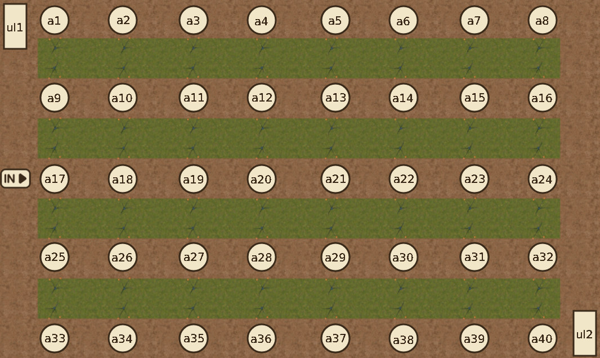

# Using the simulation

[Back to README](../README.md) · [Docker](docker.md) · [Build from source](build-from-source.md)

Run each command in its own terminal:

- **Docker:** a [container shell](docker.md#open-a-container-shell).
- **Source build:** a terminal with `source ~/catkin_ws/devel/setup.bash`.

Only one workflow should control a robot at a time: navigation, harvesting or PROST.

## Start the simulation

Docker starts it with `./docker/run.sh`. For a source build:

```bash
roslaunch harbot_simulation rbkairos_complete.launch
```

Optional arguments:

- `waypoint_robot_a:=a1 waypoint_robot_b:=a40`: spawn waypoints (A uses `a1`–`a20`, B uses `a21`–`a40`).
- `third_person_camera:=false`: turn off the camera behind each robot.
- `gripper:=four`: use the 4-finger gripper instead of the default 6-finger one (`six`). With Docker, change the `gripper` default in `docker/simulation.launch` and [rebuild the image](docker.md#build).



To watch both robots from their third-person cameras:

```bash
rosrun rviz rviz -d $(rospack find harbot_simulation)/rviz/rbkairos_camera_views.rviz
```

## Navigation

Drive a robot along a recorded route that starts at its current waypoint.

**Robot A:**

```bash
roslaunch harbot_navigation path_nav.launch robot_ns:=robot route:=a1-a2 gui:=true
```

**Robot B:**

```bash
roslaunch harbot_navigation path_nav.launch robot_ns:=robot_b route:=a40-a39 gui:=true
```

Press **Start** in the GUI. With only a destination, such as `route:=a20`, the
nearest recorded start is chosen from odometry. Launch again with a new `route`
for the next trip.

Planner and controller choices are in
[`navigation.yaml`](../harbot_navigation/config/navigation.yaml), with settings
in each component's `config.yaml` under [`harbot_navigation/scripts/`](../harbot_navigation/scripts/).

## Harvesting workflow

Start the orange detector, then the interactive workflow.

**Terminal 1:**

```bash
rosrun harbot_harvest hsv_object_detector.py
```

**Terminal 2:**

```bash
rosrun harbot_harvest harvest_workflow.py
```

For Robot B, add `_robot_ns:=/robot_b` to the detector and pick Robot B in the
workflow. The workflow asks for the robot, the path GUI, the camera view, and then:

- **Manual:** pick a destination and the oranges to harvest there.
- **Automatic:** harvest every ripe orange along the robot's waypoints, then unload.

## PROST planning

Start the detector and action server for each robot.

**Robot A:**

```bash
roslaunch harbot_harvest prost_harvest.launch robot_ns:=/robot
```

**Robot B:**

```bash
roslaunch harbot_harvest prost_harvest.launch robot_ns:=/robot_b
```

Then start the PROST planners, for both robots together:

```bash
roslaunch rbkairos_etf_services bringup_sim.launch
```

Or one robot at a time.

**Robot A:**

```bash
roslaunch rbkairos_etf_services robot1_sim.launch
```

**Robot B:**

```bash
roslaunch rbkairos_etf_services robot2_sim.launch
```

The planners decide each robot's actions, and the action servers carry them out
in the simulation. Add `dry_run:=true` to test the planners without moving the robots.

### How the planner names map to the simulation

| Planner (RDDL) | Simulation |
|---|---|
| `robot1`, `instance_robot1.rddl` | Robot A, `/robot`, waypoints `a1`–`a20` |
| `robot2`, `instance_robot2.rddl` | Robot B, `/robot_b`, waypoints `a21`–`a40` |
| `a1`–`a40` | the same waypoints as on the map above |
| `unload1`, `unload2` | unloading stations `ul1`, `ul2` |
| `l1`–`l64` (robot1), `l65`–`l128` (robot2) | an orange: `lN` is entry N of `grasp_fruit` in [`actions.json`](https://github.com/etfrobotics/rbkairos_etf_services/blob/SIM-integration/problem_data/actions.json), as `[row, tree, side, height]` |

For example, `l1` is `[1, 1, 0, 0]`, which is `orange1.1.L.B`: row 1, tree 1,
left side (`0` = L, `1` = R), bottom (`0` = B, `1` = T).

The instance files are in `rbkairos_etf_services/problem_data/`. They also set
each robot's start waypoint (`robot_at`), grasp success rate and bin capacity.
If you change the spawn waypoints, change `robot_at` to match.

### Change which oranges are ripe

Unripe oranges are set in three places, and all three must match:

1. **Planner:** `fruit_ripe(lN) = false;` in `instance_robot1.rddl` or `instance_robot2.rddl`.
2. **World:** the orange model in [`greenhouse.world`](../harbot_simulation/worlds/greenhouse.world): `model://unripe_orange` instead of `model://orange`.
3. **Harvest code:** `UNRIPE_ORANGES` in [`workflow.py`](../harbot_harvest/src/harbot_harvest/workflow.py).

The planner reads the instance files at startup, so restart the planners after
editing them. With Docker, the instance files are in
`/opt/harbot_ws/src/rbkairos_etf_services/problem_data/` inside the container.
Changes to the world or harvest code need an image rebuild.

### Run one action by hand

```bash
rosservice call /robot/sim_action_server "{action_id: 'navigate', input: [2, 0, 0, 0, 0, 0], timeout: 120.0}"
```

Actions are `navigate` (`[waypoint, 0, 0, 0, 0, 0]`, or `[0, 0, 0, 0, 1, 0]` for
`ul1`), `grasp_fruit` and `load_to_bin` (`[row, tree, side, height, 0, 0]`), and
`unload` (all zeros).
